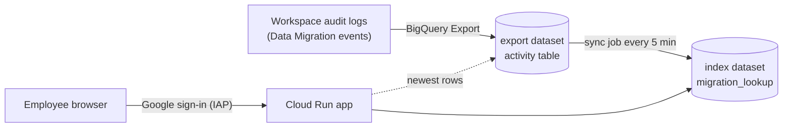

# SharePoint / OneDrive → Google Drive link finder — Customer install guide

After a Google Workspace **Data Migration** (SharePoint Online / OneDrive → My Drive or
shared drives), users still have old SharePoint/OneDrive links in mails, docs and
bookmarks. This app lets any signed-in employee paste such a link (or up to 200 at once)
and get the Google Drive link of the migrated copy. It updates itself automatically as
new migration batches run.



## 1. Before you start (checklist)

| Requirement | How to check |
|---|---|
| Google Workspace edition with **BigQuery export** of audit logs (e.g. Enterprise, Education Standard/Plus) | Admin console → Reporting → Data integrations → BigQuery Export is **on** |
| A Google Cloud project **inside your Workspace organization**, with billing | Cloud console → project picker shows it under your org |
| You have the **Owner** role on that project (and on the export project, if different) | IAM page |
| Migrations run with the Workspace **Data Migration service** (SharePoint Online / OneDrive) | Admin console → Data → Data import & export → Data migration |
| Cloud Shell (recommended) or a shell with `gcloud` and `python3` | — |

> Logs reach BigQuery only from the day the export was switched on. Turn it on **before**
> migrating; earlier migrations can't be looked up.

## 2. Install (about 10 minutes)

1. Open **Cloud Shell** in the Google Cloud console (signed in as the project Owner).
2. Upload the package (`⋮` → Upload) and unpack it:
   ```bash
   unzip gws-link-converter-*.zip && cd gws-link-converter
   ```
3. Run the installer and answer the questions (press Enter to accept a default):
   ```bash
   ./install.sh
   ```

| Question | What to enter |
|---|---|
| Project ID | Project that will host the app |
| Cloud Run region | Closest region to your users, e.g. `europe-west1`, `us-central1`, `asia-south1` |
| Cloud Run service name | URL-friendly name, default `gws-link-converter` |
| Name prefix | Prefix for the 4 service accounts it creates (5–20 chars) |
| Export project / dataset / table | Where the Workspace BigQuery export writes; the installer lists datasets that contain an `activity` table |
| Index dataset | New dataset the app creates (same location as the export) |
| Allowed domains | Workspace domains whose users may sign in (secondary domains of the same tenant are included automatically) |
| Schedules | Keep defaults (every 5 min + nightly catch-up) |
| Alert email | Gets an email if the sync fails or stops; blank = no alerts |
| App title | Optional heading shown to users |

4. The installer saves your answers to `deploy.env`, runs **preflight checks**, shows what it
   will create, asks for confirmation, deploys, runs the first sync and prints the **app URL**.
5. Share the URL with your users. Sign-in access can take a few minutes to start working.

Try it without changing anything first: `./install.sh --dry-run`.

### Preflight checks
The installer stops with a clear **FAIL** line if something is wrong, for example:

| FAIL message | Fix |
|---|---|
| `export table exists - HTTP 404` | Wrong project/dataset/table, or the export isn't enabled yet |
| `export has data_migration fields` | The export predates Data Migration logging; wait for new export rows |
| `project is in an organization` | Move the project under your Workspace organization |
| `installer permissions in project - missing ...` | Get the Owner role |
| `BQ_LOCATION matches export` | Let the installer auto-detect the location (re-run) |
| `Cloud Run region` | Pick a region from `gcloud run regions list` |

A **WARN** about an existing Cloud Run service means it will be replaced — check the name.

## 3. Using the app
* **Single link:** paste the link exactly as copied from the browser address bar or a
  document (`…-my.sharepoint.com/my?…&id=…`, `…/personal/…/Documents/…`, `/:w:/r/…`,
  `Doc.aspx?sourcedoc=…`, `AllItems.aspx?id=…`).
* **Bulk:** paste up to 200 links, one per line; export the result as CSV.
* **Folder:** shows every migrated item under a SharePoint folder.
* Results: **Found** (with Drive link), **Migration failed** (with the error),
  **Not found** (not migrated yet, or migrated before the export was on), **Unsupported**
  (sharing links like `/:x:/g/…?e=…` don't contain the file path).

## 4. What gets created
| Resource | Name (defaults) | Purpose |
|---|---|---|
| Cloud Run service | `gws-link-converter` | Web app behind Identity-Aware Proxy |
| Cloud Run job | `<prefix>-sync` | Copies new migration events into the index |
| Cloud Scheduler | `<job>-frequent`, `<job>-nightly-catchup` | Runs the job |
| BigQuery dataset | `migration_lookup` | Index (mapping table, view, sync state) |
| Service accounts | `<prefix>-app`, `-sync`, `-scheduler`, `-build` | Least-privilege identities |
| Monitoring | log metric + 2 alert policies + email channel | Sync failure / staleness alerts |

Access granted: app = read on the export + index datasets; sync job = read export, write
index; nothing gets project-wide data access. Users are limited to your allowed domains.
Every lookup is written to Cloud Logging (user, inputs, results) for audit.

Running cost is typically low: Cloud Run scales to zero; the sync job runs ~30 s every 5 min;
BigQuery scans are restricted to recent partitions.

## 5. Operate
| Task | Command |
|---|---|
| Change a setting (domains, schedule, title…) | `./install.sh` (previous answers are the defaults) |
| Re-deploy with saved settings | `./install.sh --config deploy.env --yes` |
| Check sync health | `gcloud run jobs executions list --job=<job> --region=<region>` |
| Force a sync now | `gcloud run jobs execute <job> --region=<region> --wait` |
| Preview removal | `./uninstall.sh` |
| Remove everything | `./uninstall.sh --yes` (add `--delete-index` to also drop the index dataset) |

Uninstall never deletes your Workspace export data.

## 6. Limitations (v1)
* SharePoint **sharing links** (`/:x:/g/…?e=…`) can't be resolved — they don't contain the
  file path. Open the link once and paste the address-bar URL instead.
* Only migrations logged while the BigQuery export was enabled are searchable.
* Users outside your Workspace organization can't sign in.
