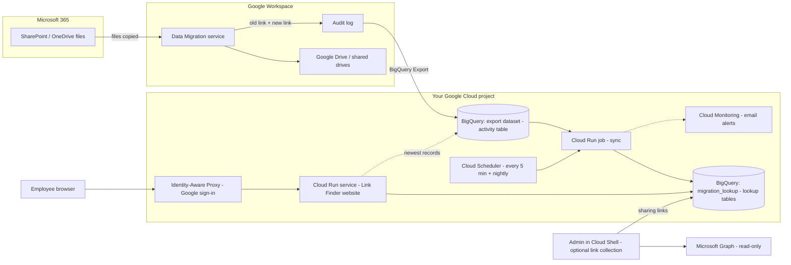
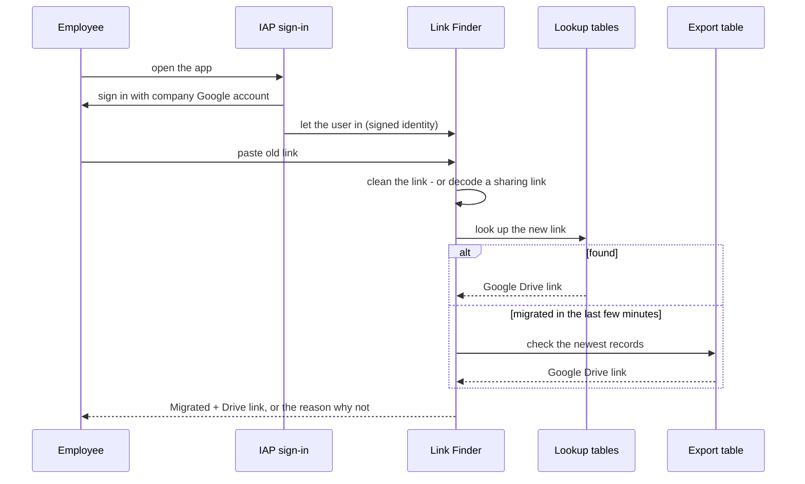

# Link Finder: customer setup guide
*SharePoint / OneDrive link → Google Drive link*

## What this app does (in one minute)
After you move files from **SharePoint / OneDrive** to **Google Drive**, people still have **old links** in emails, chats and documents.

With **Link Finder**, an employee **pastes an old link** and gets the **new Google Drive link** of the same file. This includes links sent as Outlook "modern attachments".

It runs **inside your own Google Cloud project**. Your data never leaves your organization.

**The setup has 3 stages:**
1. **Prerequisites (P1–P12):** done by you, once. Most take a few minutes.
2. **Install:** one command; the installer builds everything else.
3. **Roll out:** send the link to your employees.

---

## How it works (architecture)

### The big picture


In plain words:
1. **Files move:** the Data Migration service copies files from SharePoint/OneDrive to Google Drive.
2. **Google keeps a diary:** for every file it writes an audit-log record with the **old link** and the **new link**.
3. **The diary goes to BigQuery:** the BigQuery Export (prerequisite P10) copies those records into the `activity` table.
4. **A robot tidies it up:** every 5 minutes the **sync job** copies new migration records into the app's own **lookup tables**.
5. **People ask:** an employee signs in, pastes an old link, and the **website** looks up the new link.

### The building blocks
| Component | What it is | What it does here | Created by |
|---|---|---|---|
| BigQuery export dataset (`activity` table) | Google's copy of the Workspace audit log | Source of truth: every migrated file, old link → new link | You (P10) |
| BigQuery dataset `migration_lookup` | The app's own small database | `migration_events` (one row per migrated file), `share_links` (sharing link → file), sync bookmark | Installer |
| Cloud Run **job** (sync) | A program that runs and stops | Copies only new records, never creates duplicates | Installer |
| Cloud Scheduler | An alarm clock | Starts the sync every 5 minutes, plus a nightly catch-up | Installer |
| Cloud Run **service** | The website | Cleans pasted links, decodes sharing links, looks them up | Installer |
| Identity-Aware Proxy (IAP) | A security guard | Only your company accounts can open the website | Installer |
| Cloud Monitoring | A smoke alarm | Emails an admin if the sync fails or stops | Installer |
| Link-collection tool (optional) | A script run by an admin | Reads sharing links from Microsoft (read-only) before SharePoint is switched off | You run it (P13) |

### What happens when someone pastes a link


Which links it understands:
| Link type | Example shape | How it is resolved |
|---|---|---|
| Address-bar link | `…/personal/<user>/Documents/Report.pdf` or `/my?…&id=…` | Matched by file path |
| Office viewer link | `…/_layouts/15/Doc.aspx?sourcedoc={ID}` | Matched by SharePoint file ID |
| Sharing link / Outlook modern attachment | `…/:x:/g/personal/<user>/<code>?e=…` | File ID decoded from the code, or from the collected link list |

### Identities and permissions (least privilege)
| Identity | Used by | Access |
|---|---|---|
| `gapps-reports@system.gserviceaccount.com` | Google Workspace (BigQuery Export) | Editor on the project (P9): writes the audit log |
| `<prefix>-app` | Website | Run BigQuery queries; **read** export + lookup tables |
| `<prefix>-sync` | Sync job | Run BigQuery queries; **read** export, **write** lookup tables |
| `<prefix>-scheduler` | Cloud Scheduler | Start the sync job only |
| `<prefix>-build` | Cloud Build (install time) | Store the app's container image only |
| IAP service agent | Identity-Aware Proxy | The only identity allowed to call the website |

### Where your data lives
- **Everything stays in your Google Cloud project.** Nothing is sent to the vendor or any other company.
- BigQuery data stays in the **same location as your export** (e.g. US or EU).
- The website and job run in the **Cloud Run region** you pick at install.
- Network: employees reach the website over **HTTPS through Google sign-in**. The app talks only to Google APIs. The optional link-collection tool also calls **Microsoft Graph, read-only**, from the admin's Cloud Shell.

### Freshness and cost
- **Freshness:** a newly migrated file is usually findable within minutes. The app also checks the newest export records directly.
- **Cost:** the website **scales to zero** when unused. The sync runs about 30 seconds every 5 minutes. BigQuery reads only recent data. For most migrations the monthly cost is small.

---

## Who does what
| Person | Prerequisites | Time |
|---|---|---|
| 👤 **Google Workspace super admin** | P1, P3, P4, P10 | 15 min |
| 👤 **Google Cloud admin / project owner** | P5, P6, P7, P8, P9, P11 + Install | 30 min |
| 👤 **Migration owner** | P12 | 10 min |
| 👤 *(Optional)* **Microsoft 365 / Entra admin** | P13 | 15 min |

> One person can play several roles. Work through the steps **in order**: some depend on earlier ones.

---

# Stage 1 — Prerequisites

## P1. Check your Google Workspace edition
**Why:** the BigQuery Export feature only exists in some editions.

**Steps (super admin):**
1. Open https://admin.google.com
2. Go to **Billing → Subscriptions**.
3. Check that your edition is one of: **Enterprise Standard / Plus**, **Education Standard / Plus**, **Frontline Standard / Plus**, **Enterprise Essentials Plus**. Google's current list is in the guide linked in P10.

✅ **Done when:** your edition supports BigQuery Export.
❌ **If not:** the app can't work. Talk to your Google partner about the edition.

---

## P2. Name the people
**Why:** some steps need special admin rights.

**Steps:**
1. Name a **Google Workspace super admin**. To check: Admin console → **Account → Admin roles → Super Admin → Admins**.
2. Name a **Google Cloud admin**, who will own the project.
3. *(Optional)* Name a **Microsoft 365 / Entra admin** for P13.

✅ **Done when:** you know who does each part.

---

## P3. Allow Google Cloud (and Cloud Shell) for the installer
**Why:** the installer runs in **Cloud Shell**, a command window inside the Google Cloud website. Some companies switch Google Cloud or Cloud Shell off for users.

**Steps (super admin):**
1. Admin console → **Apps → Additional Google services**.
2. Find **Google Cloud Platform**. It must be **ON** for the installer's organizational unit.
3. Open it and check that **Cloud Shell** access is **allowed** for that person.
4. Changes can take a little while to apply.

✅ **Done when:** the installer can open https://console.cloud.google.com and click the **`>_`** (Cloud Shell) icon, and a command window opens.

---

## P4. Make sure your Google Cloud organization exists
**Why:** Google sign-in for the app only works when the project sits under **your company's organization**.

**Steps (super admin):**
1. Open https://console.cloud.google.com
2. Click the **project picker** (top bar) → **All** tab.
3. You should see your **company domain** as the organization at the top (🏢 `yourcompany.com`).
4. If you don't see it, sign in once with a super admin account. Google creates the organization for a Workspace customer automatically.

✅ **Done when:** your domain appears as an organization in the project picker.

---

## P5. Create (or choose) the Google Cloud project
**Steps (Google Cloud admin):**
1. Console → project picker → **New project**.
2. **Project name:** e.g. `link-finder`.
3. **Organization:** choose **your company domain**. ⚠️ **Not "No organization".**
4. **Location:** your organization, or a folder inside it.
5. Click **Create**. Write down the **Project ID** (e.g. `link-finder-123456`).

> Tip: using **one project** for both the BigQuery Export and the app is simplest.

✅ **Done when:** the project exists under your organization.

---

## P6. Link billing to the project
**Why:** Cloud Run, BigQuery and the export need an active billing account. Without billing, the export stops and the install fails.

**Steps (Google Cloud admin, with Billing Account Administrator or User):**
1. Console → select your project → **Menu ☰ → Billing**.
2. If it says *"This project has no billing account"*, click **Link a billing account**.
3. Choose your company billing account → **Set account**.

✅ **Done when:** the Billing page shows a billing account linked to the project.

---

## P7. Give the installer the Owner role
**Why:** the installer creates the service, job, schedules, robot accounts and database, and sets their permissions.

**Steps (Google Cloud admin):**
1. Console → your project → **Menu ☰ → IAM & Admin → IAM**.
2. Click **Grant access**.
3. **New principals:** the installer's email (e.g. `it-admin@yourcompany.com`).
4. **Role:** **Basic → Owner**.
5. Click **Save**.

> If the BigQuery Export is in a **different project**, the installer also needs Owner (or BigQuery Admin) there.

✅ **Done when:** the installer appears in IAM with the **Owner** role.

---

## P8. Switch on the required Google Cloud services (APIs)
**Why:** the app uses 10 Google Cloud services. In a new project they are **off**. If they are still off when the installer starts, its checks stop with a warning, or (in older versions) get stuck.

**Who:** Google Cloud admin with the **Owner** role (or *Service Usage Admin*). **Billing (P6) must be linked first.**

**Option 1: one command in Cloud Shell (easiest)**
1. Open **Cloud Shell** (`>_` icon in the Google Cloud console).
2. Paste this, replacing `YOUR_PROJECT_ID` with your project ID (lowercase), and press **Enter**:
```bash
gcloud services enable \
  run.googleapis.com \
  cloudbuild.googleapis.com \
  artifactregistry.googleapis.com \
  cloudscheduler.googleapis.com \
  iap.googleapis.com \
  bigquery.googleapis.com \
  logging.googleapis.com \
  monitoring.googleapis.com \
  cloudresourcemanager.googleapis.com \
  storage.googleapis.com \
  --project=YOUR_PROJECT_ID
```
3. Wait 1–2 minutes until it says **"Operation … finished successfully."**
4. Check:
```bash
gcloud services list --enabled --project=YOUR_PROJECT_ID
```
All 10 names should be in the list.

**Option 2: click in the console**
1. Open https://console.cloud.google.com and **select your project** at the top.
2. Go to **Menu ☰ → APIs & Services → Library**.
3. Search for each name below, open it, click **Enable**:

| # | Search for | Why the app needs it |
|---|---|---|
| 1 | **Cloud Run Admin API** | Runs the website and the sync job |
| 2 | **Cloud Build API** | Builds the app from the code |
| 3 | **Artifact Registry API** | Stores the built app |
| 4 | **Cloud Scheduler API** | Runs the sync every 5 minutes |
| 5 | **Cloud Identity-Aware Proxy API** | Google sign-in in front of the app |
| 6 | **BigQuery API** | Reads the audit log, stores the lookup tables |
| 7 | **Cloud Logging API** | Logs and the install record |
| 8 | **Cloud Monitoring API** | Email alerts |
| 9 | **Cloud Resource Manager API** | Project and sign-in policy settings |
| 10 | **Cloud Storage API** | Holds the uploaded code during the build |

4. Check: **APIs & Services → Enabled APIs & services** lists all 10.

> If you see *"Permission denied"* or *"blocked by organization policy"*, your company restricts which services can be switched on. Ask your Google Cloud admin to enable these 10 for this project (see also P11).

✅ **Done when:** all 10 services show as **enabled** for the project.

---

## P9. Prepare the project for the BigQuery Export
**Why:** Google Workspace writes the logs using its own system account, **`gapps-reports@system.gserviceaccount.com`**. That account needs permission in your project.

**Steps (Google Cloud admin):**
1. Console → your project → **Menu ☰ → APIs & Services → Library**.
2. Search **BigQuery API** → open it → click **Enable** (if it isn't already on).
3. Go to **Menu ☰ → IAM & Admin → IAM → Grant access**.
4. **New principals:** `gapps-reports@system.gserviceaccount.com`
5. **Role:** **Basic → Editor**.
6. Click **Save**.

> Some organizations block adding accounts from outside their domain (the policy *"Domain restricted sharing"*). If saving fails with a policy error, see P11.

✅ **Done when:** IAM lists `gapps-reports@system.gserviceaccount.com` with **Editor**.

---

## P10. Turn on the BigQuery Export ⭐ (most important)
**Why:** this copies the Workspace **audit log** into BigQuery. The log records every migrated file (old link + new link), and the app reads it.

> [!IMPORTANT]
> Do this **before** you migrate files. Files migrated **before** this step **cannot** be found by the app.

**Steps (super admin):**
1. Open https://admin.google.com
2. Go to **Menu ☰ → Reporting → Data integrations**.
3. On the **BigQuery Export** card, click **Edit ✏️**.
4. Tick **Enable Google Workspace data export to Google BigQuery**.
5. **Project ID:** the project from P5.
6. **Dataset:** type a **new** name that doesn't exist yet, e.g. `workspace_logs`. Google creates it for you.
7. Click **Save**.

📖 Official Google guide: https://support.google.com/a/answer/9079365

**How to check it worked (Google Cloud admin):**
1. Console → **BigQuery**.
2. In the left panel, open your project → you should see the dataset (e.g. `workspace_logs`).
3. Inside it, a table called **`activity`** should appear. This can take some time after you switch the export on.

✅ **Done when:** the **`activity`** table exists.

---

## P11. Check organization policies (only if your company uses them)
**Why:** some companies set rules that can block the install. Most don't.

**Steps (Google Cloud admin or organization policy admin):**
1. Console → your project → **Menu ☰ → IAM & Admin → Organization Policies**.
2. Search for each policy below and check its value:

| Policy (search for) | Must allow | Why |
|---|---|---|
| **Domain restricted sharing** (`iam.allowedPolicyMemberDomains`) | Your Workspace customer ID, **and** the export account from P9 (Google's guide covers this case) | Lets the export write logs and the app grant access to your domain |
| **Resource location restriction** (`gcp.resourceLocations`) | The **region** you'll choose at install, plus your BigQuery export location | The installer creates resources there |
| **Allowed ingress settings (Cloud Run)** (`run.allowedIngress`) | **All** | Employees reach the app over the internet, behind Google sign-in |
| **Restrict Cloud Run invoker / public access** policies | Access by Google's sign-in service (IAP) | The app uses IAP; it is **not** public |

3. If one blocks you, ask your organization policy admin to add an exception **for this project only**.

✅ **Done when:** none of these policies block the project, or exceptions are in place.

---

## P12. Check your migration plan
**Why:** the app can only find files that were really migrated, and links point to the **sender's** OneDrive.

**Steps (migration owner), in the Data Migration service settings:**
1. ✅ Migrate the OneDrive of **every person who sends files**.
2. ✅ Include each user's OneDrive **`Attachments`** folder. Outlook saves files attached from a computer there, and those become "modern attachment" links.
3. ✅ Migrate the people who **receive** links too, so their access can be carried over.
4. ✅ Run migrations **after** P10.
5. ℹ️ After a migration, if a file shows the warning **`DrivePermissionRestricted`**, its sharing permissions were not fully copied. The app still finds the file, but the receiver may need to **request access**.

✅ **Done when:** the migration scope includes all senders and their `Attachments` folders.

---

## P13. *(Optional, recommended)* Create a read-only Microsoft app
**Why:** most modern sharing links are understood by the app directly. **Older link formats** need an "address book" collected from Microsoft **while SharePoint is still on**. This app gives read-only access for that.

**Steps (Microsoft Entra admin):**
1. Open https://entra.microsoft.com → **Applications → App registrations → New registration**.
2. **Name:** `Link Finder (read-only)` → **Accounts in this organizational directory only** → **Register**.
3. Copy the **Application (client) ID** and the **Directory (tenant) ID**.
4. **API permissions → Add a permission → Microsoft Graph → Application permissions** → tick **`Sites.Read.All`** → **Add**.
5. Click **Grant admin consent for <your tenant>** → **Yes**.
6. **Certificates & secrets → New client secret** → choose an expiry → **Add** → copy the **Value** right away (it's shown only once).
7. Give the **tenant ID, client ID and secret** to the Google Cloud admin **securely**: a password manager, not email or chat.

📖 Microsoft guide: https://learn.microsoft.com/en-us/graph/auth-v2-service

✅ **Done when:** you have the 3 values and admin consent shows ✅ "Granted".

---

## ✅ Prerequisites summary
| # | Item | Done |
|---|---|---|
| P1 | Workspace edition supports BigQuery Export | ☐ |
| P2 | Super admin and Google Cloud admin named | ☐ |
| P3 | Google Cloud + Cloud Shell allowed for the installer | ☐ |
| P4 | Organization visible in the Google Cloud console | ☐ |
| P5 | Project created **inside the organization** | ☐ |
| P6 | Billing linked | ☐ |
| P7 | Installer has **Owner** | ☐ |
| P8 | 10 required Google Cloud services (APIs) **enabled** | ☐ |
| P9 | BigQuery API on + `gapps-reports@system.gserviceaccount.com` = **Editor** | ☐ |
| P10 | BigQuery Export **ON**, and the `activity` table exists | ☐ |
| P11 | No organization policy blocks the project | ☐ |
| P12 | Migration includes senders and `Attachments` folders | ☐ |
| P13 | *(Optional)* Read-only Microsoft app created | ☐ |

---

# Stage 2 — Install Link Finder (about 15 minutes)

### Step 1: Open Cloud Shell
Console → your project → click **`>_` (Activate Cloud Shell)** at the top right.

### Step 2: Upload the package
In Cloud Shell, click **⋮ (More) → Upload** and choose the `.zip`. Then:
```bash
unzip gws-link-converter-*.zip
cd gws-link-converter
```

### Step 3: Practice run (changes nothing)
```bash
./install.sh --dry-run
```

### Step 4: Real install
```bash
./install.sh
```
**Press Enter to accept the suggestion in [brackets].**

| Question | What to answer |
|---|---|
| Project ID | The project from P5 (suggested) |
| Cloud Run region | Near your users and allowed by P11, e.g. `europe-west1`, `us-central1`, `asia-south1` |
| Cloud Run service name | Keep `gws-link-converter` |
| Name prefix | Keep `link-converter` |
| Sync job name | Keep the suggestion |
| Export project / dataset / table | The installer **lists the datasets it finds**: pick the one from P10. Table = `activity` |
| Index dataset | Keep `migration_lookup` |
| Allowed domains | Your company domain(s) (suggested) |
| Schedules | Keep the suggestions |
| Alert email | An admin email for alerts |
| App title | Optional name shown to users |

### Step 5: Read the checks
- **PASS**: good.
- **WARN**: read it, usually fine.
- **FAIL**: the installer stops and **changes nothing**. The message says which prerequisite to fix (see Troubleshooting). Then run `./install.sh` again; your answers are remembered.

### Step 6: Confirm
At **"Deploy now?"** type **`y`**. The installer builds:
- 🤖 4 robot accounts with **minimum** access
- 📊 the lookup database
- 🌐 the website, with Google sign-in for your domains only
- 🔄 a copy job every 5 minutes, plus a nightly catch-up
- 🚨 email alerts
- ▶️ a first fill of the lookup list

### Step 7: Get your link
```
Done. App URL: https://<your-service>-....run.app
```
🎉 Open it, sign in, and paste a migrated file's old link to test.

> Sign-in can take a few minutes to start working after the first install.

---

### Step 8: Read the results (logs)
Every run of the installer records **what was checked and what happened**:
- At the end it prints a **summary** with each item marked **PASS**, **WARN** or **FAIL**, an overall **Result** (SUCCESS / FAILED / DRY RUN OK), and, if something failed, **what to do next**.
- The same information is saved in the `logs/` folder (inside `gws-link-converter`):

| File | What's inside |
|---|---|
| `logs/install-<date-time>-summary.txt` | The PASS / WARN / FAIL summary (easy to read or email) |
| `logs/install-<date-time>.log` | Everything that was printed during the run (for support) |
| `logs/install-<date-time>-summary.json` | The same summary in machine-readable form |

- It is also written to **Cloud Logging** in your project (log name **`link-finder-install`**; failed runs are marked **ERROR**). To see it: Google Cloud console → **Logging → Logs Explorer** → search `logName:"link-finder-install"`.

To see the latest summary in Cloud Shell:
```bash
ls -t logs/*-summary.txt | head -1 | xargs cat
```

**Health check at any time** (changes nothing):
```bash
./install.sh verify
```
It checks that the website is running, sign-in is enforced, anonymous visitors are blocked, the copy job ran successfully, the schedules are on, the lookup data is fresh, and alerts are configured. Each item is marked PASS / WARN / FAIL.

> When asking for help, send the **summary file**. It contains no passwords.

---

# Stage 3 — Roll out
1. Send employees the **App URL**.
2. They sign in with their **company Google account**.
3. They paste an old link: from an email (modern attachment), copied with **"Copy link"**, from the browser address bar, or up to **200 links** at once.
4. They get **Migrated** + the new Google Drive link, or a clear reason why not.

---

## Before SharePoint is switched off (needs P13)
In Cloud Shell, in the `gws-link-converter` folder:
```bash
export GRAPH_TENANT_ID=...  GRAPH_CLIENT_ID=...  GRAPH_CLIENT_SECRET=...
set -a; source deploy.env; set +a
export GCP_PROJECT=$PROJECT_ID BQ_SOURCE_TABLE=$EXPORT_TABLE BQ_DATASET=$INDEX_DATASET
python3 -m tools.harvest_share_links --from-index --load
```
Run it 🔁 after each migration wave, 🔁 a few days before cutover, and 🔁 **one last time** when SharePoint becomes **read-only**.

---

## After setup (day-to-day)
| I want to… | Do this in Cloud Shell (inside the folder) |
|---|---|
| Change a setting | `./install.sh` (old answers are the defaults) |
| Install a new version | Unzip the new package, copy in your `deploy.env`, run `./install.sh --config deploy.env --yes` |
| Check everything is healthy | `./install.sh verify` |
| See the latest install/health result | Open the newest `logs/install-…-summary.txt` file (see Stage 2, Step 8) |
| Check the copy job | `gcloud run jobs executions list --job=link-converter-sync --region=<region>` |
| Force a refresh now | `gcloud run jobs execute link-converter-sync --region=<region> --wait` |
| Preview an uninstall | `./uninstall.sh` |
| Remove everything | `./uninstall.sh --yes --delete-index` |

> Keep **`deploy.env`** safe; it holds your answers (no passwords).
> Uninstall **never deletes** your Workspace audit log data.

---

## 🛠️ Troubleshooting
| Message | Fix (prerequisite) |
|---|---|
| Cloud Shell won't open | **P3** |
| Installer stops at *Cloud Run region* (timed out / "API not enabled" / `SERVICE_DISABLED`) | **P8**: switch on the required services, then run `./install.sh` again |
| `FAIL project is in an organization` | **P4 / P5**: project must be under your organization |
| `FAIL billing enabled` | **P6** |
| `FAIL installer permissions` | **P7** |
| `FAIL export table exists` | **P9 / P10**: export not on, wrong dataset, or table not created yet |
| `FAIL export has data_migration fields` | **P10 / P12**: no migration has run since the export was switched on |
| Install fails with *"violates constraint …"* | **P11**: organization policy |
| `FAIL Cloud Run region` | Pick a valid region allowed by **P11** |
| `WARN … will be REPLACED` | A service with that name exists: choose another name |
| App says **Not found** | File not migrated, or migrated before **P10** |
| **Migrated**, but Drive says **Request access** | `DrivePermissionRestricted` (**P12**): ask the owner to share |
| Older link: "can't be decoded offline" | Run the link collection (**P13**) while SharePoint is on |

---

## 🔒 Security summary (for your security team)
- Runs **entirely in your Google Cloud project**. No data goes to the vendor or any third party.
- **Only your company accounts** can sign in (Google sign-in through Identity-Aware Proxy).
- Robot accounts have **minimum access**: read-only on the audit log, write only to the app's own tables.
- The audit log is **never modified**.
- Every lookup is **logged** (who searched what) in Cloud Logging.
- The optional Microsoft app (P13) is **read-only**, and its secret is **never stored in files**.

---

## ✍️ Sign-off checklist
- [ ] All prerequisites P1–P12 done (P13 if older links matter)
- [ ] `./install.sh` finished and printed the App URL
- [ ] A test link returns **Migrated**
- [ ] App URL shared with employees
- [ ] Link collection scheduled before SharePoint shutdown (P13)
- [ ] `deploy.env` saved safely; alert email confirmed
