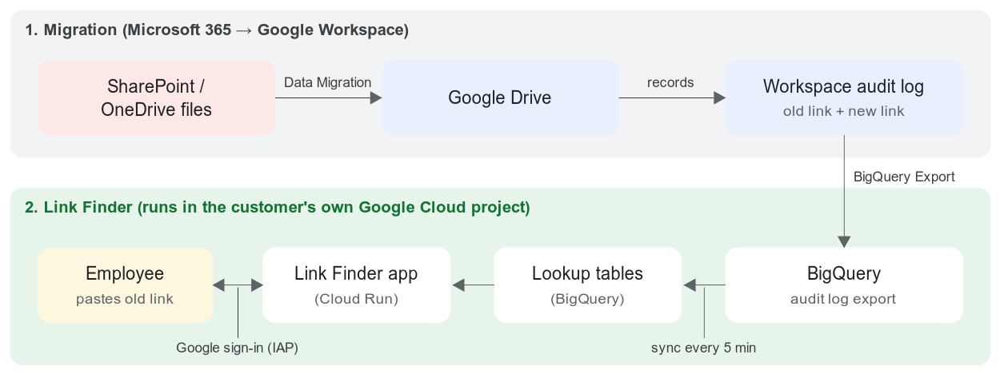

# LinkFinder
**Find the Google Drive copy of any SharePoint / OneDrive link.** *Developed by Yabhi.*

After files are moved from SharePoint Online / OneDrive to Google Drive with the Google Workspace **Data Migration service**, old links (in emails, chats, documents, bookmarks and Outlook "modern attachments") still point to SharePoint. LinkFinder lets employees paste an old link, or up to 200 at once, and get the Google Drive link of the migrated copy. It keeps working after SharePoint is switched off.

LinkFinder reads the Workspace audit log exported to BigQuery (`<export project>.<dataset>.activity`, records with `record_type = data_migration`), keeps its own lookup tables up to date every 5 minutes, and serves a small web app behind Google sign-in (Identity-Aware Proxy). One installation runs in one organization's own Google Cloud project.



## Documentation
| Document | For | What's inside |
|---|---|---|
| [ADMIN_GUIDE.md](ADMIN_GUIDE.md) | **Admins installing LinkFinder** | Prerequisites P1–P13 with steps, architecture, install, logs and health check, rollout, troubleshooting, security summary |
| [TECHNICAL_GUIDE.md](TECHNICAL_GUIDE.md) | IT / developers | Configuration reference, resources, data model, sync, lookup logic, sharing links, API, security, runbook |
| [LICENSING_AND_COST.md](LICENSING_AND_COST.md) | Decision makers | What to license/purchase, Google Cloud products used, cost model and a 5,000-user example |
| [ONE_PAGER.md](ONE_PAGER.md) | Everyone | Problem, how LinkFinder solves it, architecture, requirements |

## Quick start (admins)
Prerequisites: a Workspace edition with **BigQuery Export** switched on **before** migrating, a Google Cloud project inside your organization with billing, the Owner role, and the required services enabled (see [ADMIN_GUIDE.md](ADMIN_GUIDE.md), P1–P13).

In **Cloud Shell**:
```bash
unzip gws-link-converter-*.zip && cd gws-link-converter   # or: git clone this repository
./install.sh --dry-run      # practice run: questions + safety checks, nothing is changed
./install.sh                # install: asks, checks, deploys, first sync, health check, prints the app URL
./install.sh verify         # health check at any time (PASS / WARN / FAIL)
```
Every run writes `logs/install-<time>.log` and a PASS/WARN/FAIL summary (`logs/install-<time>-summary.txt`), plus an entry in Cloud Logging (log name `link-finder-install`).

## What links it understands
| Link | Example shape | Resolved by |
|---|---|---|
| Address-bar / file path | `https://<t>-my.sharepoint.com/personal/<u>/Documents/file.pdf`, `/my?viewid=…&id=…`, `…/Forms/AllItems.aspx?id=…` | File path |
| Office "path" link | `/:w:/r/…` | File path |
| Office viewer link | `/_layouts/15/Doc.aspx?sourcedoc={GUID}` | SharePoint file ID |
| **Sharing link / Outlook modern attachment** | `/:x:/g/personal/<owner>/<token>?e=…` | File ID decoded from the token, or the collected sharing-link list (`share_links`) |

Results: `FOUND` (with the Drive link), `MIGRATION_FAILED` (with the reason), `NOT_FOUND`, `UNSUPPORTED`, `INVALID`. "Migrated" means `CREATE_FILE` / `CREATE_FOLDER` with `SUCCEEDED` or `SUCCEEDED_WITH_WARNINGS`; the latest successful attempt wins.

## Scripts
| Script | Purpose |
|---|---|
| `install.sh` | Interactive installer: asks / auto-detects settings, writes `deploy.env`, preflight checks, deploy, first sync, health check, summary and logs |
| `install.sh --dry-run` / `preflight` / `verify` | Practice run / checks only / post-install health check |
| `install.sh --config deploy.env --yes` | Non-interactive install or upgrade with saved settings |
| `setup.sh [--config F] [steps]` | Idempotent provisioning steps: `apis iam schema service iap job schedule alerts` (`show` prints resolved settings); each step reports PASS/FAIL |
| `uninstall.sh [--config F] [--yes] [--delete-index]` | Removes what was installed (dry run by default); never touches the Workspace export |
| `package.sh [ref]` | Builds a shareable zip from a git ref into `dist/` |
| `python3 -m tools.harvest_share_links` | Optional: collect sharing links from Microsoft Graph (read-only) before SharePoint shutdown |
| `python3 -m tools.import_share_links file.csv` | Optional: load `url,item_guid` sharing-link mappings |

All deployment values live in `deploy.env` (written by `install.sh`; template `deploy.env.example`). Nothing organization-specific is hardcoded.

## How it works
```
Workspace Data Migration ──audit log──▶ BigQuery <export>.activity   (near real time)
                                              │ every 5 min: Cloud Scheduler ▶ Cloud Run job (tools.sync_job)
                                              ▼ (nightly: same job, 72 h catch-up)
                     BigQuery <INDEX_DATASET>.migration_events (+ share_links)
                                              │
 browser ──Google sign-in (IAP)──▶ Cloud Run LinkFinder app ──▶ lookup ──not found──▶ live check of export
                                                                                     rows newer than the last sync
```
* `sql/sync.sql`: idempotent incremental MERGE (insert-if-absent on `event_id`, watermark advanced in the same transaction, 2 h re-read, 1-day partition margin). The first run is the backfill.
* `app/normalize.py` + `app/sharelink.py`: turn any pasted link into a lookup key or a SharePoint file ID.
* `app/repository.py`: lookup order is path / file ID → collected sharing links → decoded token → live check of the newest export rows.

## BigQuery objects (`<PROJECT_ID>.<INDEX_DATASET>`, default `migration_lookup`)
| Object | Purpose |
|---|---|
| `migration_events` | Every file/folder migration attempt (partitioned by day, clustered by `source_key`, `source_item_guid`) |
| `migration_executions`, `migration_waves` | Execution → wave → batch name |
| `share_links` | Sharing link (`<host>/<token>`) → SharePoint file ID, collected before SharePoint shutdown |
| `sync_state` | Watermark, last run time and row count |
| `normalize_uri()` | JavaScript UDF, same rules as `normalize.py` for logged URIs |
| `uri_mapping_current` | View: the current mapping per source (for reporting and exports) |

No table has an expiry; the index is kept until removed with `./uninstall.sh --yes --delete-index`.

## Identities (least privilege)
| Service account | Permissions |
|---|---|
| `<prefix>-app` | `bigquery.jobUser` (project); READER on the export dataset and the index dataset |
| `<prefix>-sync` | `bigquery.jobUser`; READER on the export dataset, WRITER on the index dataset |
| `<prefix>-scheduler` | `run.jobsExecutorWithOverrides` on the sync job only |
| `<prefix>-build` | Cloud Build: objectViewer on the `run-sources-…` bucket, Artifact Registry writer, logWriter |
| IAP service agent | `run.invoker` on the service (the only invoker) |

## Local development
```bash
python3 -m venv .venv && .venv/bin/pip install -r requirements.txt httpx
.venv/bin/python -m unittest discover -s tests          # offline unit + API tests
set -a; source deploy.env; set +a
GCP_PROJECT=$PROJECT_ID BQ_SOURCE_TABLE=$EXPORT_TABLE BQ_DATASET=$INDEX_DATASET \
  RUN_BQ_TESTS=1 .venv/bin/python -m unittest discover -s tests   # + BigQuery integration (needs gcloud auth)
GCP_PROJECT=$PROJECT_ID BQ_SOURCE_TABLE=$EXPORT_TABLE BQ_DATASET=$INDEX_DATASET \
  AUTH_MODE=dev .venv/bin/uvicorn app.main:app --port 8080         # local UI; dev mode refuses to start on Cloud Run
```
The operations runbook (sync now, logs, rollback, upgrade) is in [TECHNICAL_GUIDE.md](TECHNICAL_GUIDE.md), section 12.

## Limitations
* Only migrations logged **after** the BigQuery Export was switched on can be found.
* A sharing link resolves only if its token format can be decoded, or it was collected before SharePoint was switched off.
* Users outside the project's Workspace organization can't sign in.
* LinkFinder returns links; it doesn't grant Drive access (e.g. items migrated with `DrivePermissionRestricted`).

---
*LinkFinder · Developed by Yabhi*
