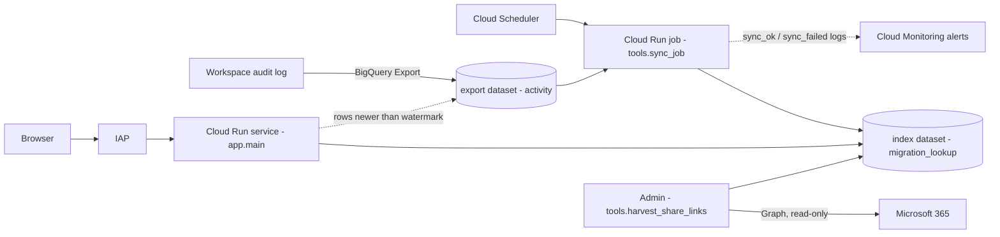

# LinkFinder: Technical & Administration Guide
*For IT administrators, developers and support teams who configure, operate or extend LinkFinder.*

> End users and first-time installers should start with the **Admin Guide** (`ADMIN_GUIDE.md`: prerequisites and install). This document is the technical reference.

## 1. Purpose
LinkFinder maps **SharePoint Online / OneDrive links** to the **Google Drive links** of the same items after a Google Workspace **Data Migration**. It reads the Workspace audit log (exported to BigQuery), keeps an incremental lookup index, and serves a small web app behind Google sign-in (Identity-Aware Proxy).

| Item | Value |
|---|---|
| Runtime | Python 3 (FastAPI + Uvicorn) on Cloud Run |
| Data store | BigQuery (export dataset: read-only; index dataset: read/write) |
| Scheduling | Cloud Scheduler → Cloud Run job |
| Authentication | Identity-Aware Proxy (IAP), Google accounts of allowed Workspace domains |
| External dependencies | None at runtime. Optional: Microsoft Graph (read-only), used by an admin-run tool |
| Deployment model | One installation per organization, in its own Google Cloud project (single tenant) |

## 2. Architecture


| Component | Resource name (default) | Code |
|---|---|---|
| Web app | Cloud Run service `SERVICE_NAME` (`gws-link-converter`) | `app/main.py`, `app/repository.py`, `app/normalize.py`, `app/sharelink.py`, `app/auth.py`, `app/static/` |
| Sync | Cloud Run job `JOB_NAME` (`<prefix>-sync`) | `tools/sync_job.py`, `sql/sync.sql` |
| Schedules | `<job>-frequent` (`SYNC_CRON`), `<job>-nightly-catchup` (`CATCHUP_CRON`, 72 h overlap) | `setup.sh step_schedule` |
| Index | BigQuery dataset `INDEX_DATASET` (`migration_lookup`) | `sql/schema.sql` |
| Alerts | log metric `<job>_ok` + 2 alert policies + email channel | `monitoring/*.json`, `setup.sh step_alerts` |
| Link collection (optional) | — (run from Cloud Shell) | `tools/harvest_share_links.py`, `tools/graph.py`, `tools/import_share_links.py` |

## 3. Repository layout
| Path | Purpose |
|---|---|
| `install.sh` | Interactive installer: asks/auto-detects settings, writes `deploy.env`, preflight, deploy, first sync, health check; modes `--dry-run`, `preflight`, `verify`; writes `logs/` |
| `setup.sh` | Idempotent provisioning steps: `apis iam schema service iap job schedule alerts`; `show` prints resolved settings |
| `uninstall.sh` | Removes a deployment (dry run unless `--yes`; `--delete-index` drops the index dataset) |
| `package.sh` | Builds a zip from a git ref (`git archive`) |
| `deploy.env.example` | Template of the configuration file |
| `app/config.py` | Runtime configuration from environment variables; fail-fast validation |
| `app/bq.py` | Minimal BigQuery REST client (stdlib) |
| `app/normalize.py` | Canonicalizes pasted URLs into lookup keys |
| `app/sharelink.py` | Parses sharing links and decodes share tokens |
| `app/repository.py` | Lookup logic (index → live fallback; sharing links) |
| `app/auth.py` | IAP JWT verification and domain allow-list |
| `app/main.py` | HTTP API and static UI |
| `sql/schema.sql`, `sql/sync.sql` | Index DDL and incremental sync script |
| `tools/` | `run_sql`, `sync_job`, `grant_dataset`, `preflight` (safety checks), `verify` (health check), `install_summary` (PASS/WARN/FAIL summary), `run_sql_drop`, `import_share_links`, `graph`, `harvest_share_links` |
| `app/static/` | Web UI (`index.html`, `app.js`, `app.css`) |
| `docs/` | Architecture diagram (`link-finder-architecture.png` / `.svg`) |
| `ADMIN_GUIDE.md`, `LICENSING_AND_COST.md`, `ONE_PAGER.md` | Admin install guide, licensing & cost, one-page summary |
| `tests/` | Unit tests (offline) and BigQuery integration tests (`RUN_BQ_TESTS=1`) |
| `monitoring/` | Alert policy templates |

## 4. Configuration reference

### 4.1 `deploy.env` (written by `install.sh`, read by `setup.sh` / `uninstall.sh`)
| Key | Required | Default | Meaning |
|---|---|---|---|
| `PROJECT_ID` | ✅ | — | Project hosting the service, job, index dataset; BigQuery jobs run here |
| `PROJECT_NUMBER` | | looked up | Used for the IAP audience and the IAP service agent |
| `REGION` | ✅ | — | Cloud Run region (service, job, build bucket, image repository) |
| `SERVICE_NAME` | ✅ | — | Cloud Run service name |
| `NAME_PREFIX` | | `link-converter` | Prefix of the 4 service accounts (5–20 chars) |
| `JOB_NAME` | | `<prefix>-sync` | Cloud Run job name |
| `EXPORT_TABLE` | ✅ | — | Workspace export table `project.dataset.activity` (may be in another project) |
| `BQ_LOCATION` | | `US` | Location of the export dataset; the index dataset is created there |
| `INDEX_DATASET` | | `migration_lookup` | Index dataset name in `PROJECT_ID` |
| `ALLOWED_DOMAINS` | ✅ | — | Comma-separated Workspace domains allowed to sign in |
| `SYNC_CRON` | | `*/5 * * * *` | Frequent sync schedule (UTC) |
| `CATCHUP_CRON` | | `17 2 * * *` | Nightly catch-up schedule (UTC), 72 h re-read |
| `ALERT_EMAIL` | | — | Alert recipient; blank = no alert policies |
| `APP_TITLE` | | `LinkFinder` | Heading shown in the UI (the footer "LinkFinder · Developed by Yabhi" is always shown) |
| `SCHEDULE_NAME`, `CATCHUP_SCHEDULE_NAME` | | `<job>-frequent`, `<job>-nightly-catchup` | Advanced: custom schedule names |
| `SCHEDULER_REGION` | | `REGION` | Advanced: Cloud Scheduler location |
| `METRIC_NAME` | | `<job>_ok` (dashes → underscores) | Advanced: log metric name |
| `SYNC_MAX_BYTES` | | `21474836480` (20 GiB) | BigQuery byte cap for the sync job |

`deploy.env` contains **no secrets**. Keep it with your change records; it's needed to update or uninstall.

### 4.2 Runtime environment variables
| Variable | Service | Job | Meaning |
|---|---|---|---|
| `GCP_PROJECT` | ✅ | ✅ | Project for BigQuery jobs and the index dataset |
| `BQ_SOURCE_TABLE` | ✅ | ✅ | Export table `project.dataset.table` |
| `BQ_DATASET` | ✅ | ✅ | Index dataset |
| `BQ_LOCATION` | ✅ | ✅ | BigQuery location |
| `BQ_MAX_BYTES` | default 2 GiB | set from `SYNC_MAX_BYTES` | `maximumBytesBilled` per query |
| `AUTH_MODE` | `iap` | — | `iap` (production) or `dev` (local only; refused on Cloud Run) |
| `IAP_AUDIENCE` | ✅ | — | `/projects/<number>/locations/<region>/services/<service>` |
| `ALLOWED_DOMAIN` | ✅ | — | Allowed domains, `;`-separated |
| `APP_TITLE` | optional | — | UI heading |
| `MAX_BULK` | default 500 (set via `deploy.env`) | — | Max links per bulk request. Keep ≤ ~800: each request writes one audit log entry listing the inputs, and Cloud Logging entries are limited to 256 KB |
| `SYNC_OVERLAP_HOURS` | — | default 2 | Re-read window before the watermark |

Missing required values make the service/job **fail at startup** with an explicit error (no silent defaults).

### 4.3 Changing configuration
- **Interactive:** `./install.sh` (previous answers are the defaults).
- **Scripted:** edit `deploy.env`, then `./install.sh --config deploy.env --yes`, or run selected steps, e.g. `./setup.sh --config deploy.env service job`.
- **Preview resolved values:** `./setup.sh --config deploy.env show`.
- **Checks only:** `./install.sh preflight --config deploy.env`.

## 5. Resources created by the installer
| Resource | Name | Notes |
|---|---|---|
| APIs | run, cloudbuild, artifactregistry, cloudscheduler, iap, bigquery, logging, monitoring, cloudresourcemanager, storage | `step_apis` |
| Service account | `<prefix>-app` | `roles/bigquery.jobUser` (project); READER on export + index datasets |
| Service account | `<prefix>-sync` | `roles/bigquery.jobUser`; READER on export, WRITER on index |
| Service account | `<prefix>-scheduler` | `roles/run.jobsExecutorWithOverrides` on the job only |
| Service account | `<prefix>-build` | `roles/logging.logWriter`; objectViewer on the source bucket; writer on the image repository |
| Bucket | `run-sources-<project>-<region>` | Cloud Run source uploads (shared; kept on uninstall) |
| Artifact Registry | `cloud-run-source-deploy` (`<region>`) | Container images (shared; kept on uninstall) |
| BigQuery dataset | `<INDEX_DATASET>` | Tables, UDF and view (section 6) |
| Cloud Run service | `<SERVICE_NAME>` | `--no-allow-unauthenticated --iap`, ingress all, 0–3 instances, 1 vCPU / 512 MiB, timeout 60 s |
| IAM on service | `run.invoker` → IAP service agent only | |
| IAP policy | `domain:<each allowed domain>` → `roles/iap.httpsResourceAccessor` | Secondary domains of the same tenant are covered by the primary domain |
| Cloud Run job | `<JOB_NAME>` | Same image; `python -m tools.sync_job`; 1 task, 1 retry, 600 s timeout |
| Scheduler | 2 HTTP jobs (OAuth as `<prefix>-scheduler`) | Call `jobs:run` (nightly passes arg overrides) |
| Monitoring | log metric, email channel, 2 alert policies | Only if `ALERT_EMAIL` is set |

## 6. Data model (index dataset)
| Object | Type | Key columns / purpose |
|---|---|---|
| `migration_events` | table, partitioned by `DATE(event_time)`, clustered by `source_key, source_item_guid` | One row per file/folder migration attempt (`CREATE_FILE` / `CREATE_FOLDER`), any status. Insert-only, unique `event_id`. Columns: `event_time, event_status, source_uri, source_key, source_item_guid, target_uri, target_id, warning_code, warning_title, migrated_by, execution_id, …` |
| `migration_executions` | table | `execution_id → wave_id, execution_type (Full/Delta)` |
| `migration_waves` | table | `wave_id → batch_name` |
| `share_links` | table, clustered by `share_key` | `share_key` (`<host>/<token>`, token case-sensitive) → `item_guid`; `source` = harvest / live / import; latest row wins |
| `sync_state` | table | `name='activity'`: `watermark_usec, last_run_at, last_inserted` |
| `normalize_uri(u)` | JavaScript UDF | Same canonicalization as `app/normalize.py` for logged URIs |
| `uri_mapping_current` | view | Latest **successful** mapping per `source_key`, with batch info (for reporting / export) |

**Source fields used from the export (`activity`):** `record_type='data_migration'`, `event_type`, `event_name`, `time_usec`, `status.event_status`, `data_migration.source_uri`, `data_migration.target_uri`, `data_migration.source_identifier` (`documentLibraries/<lib>/files/<GUID>`), `data_migration.execution_id`, `data_migration.migration_error_code/title`, `email`, `_PARTITIONTIME`.

"Migrated" = `CREATE_FILE`/`CREATE_FOLDER` with `SUCCEEDED` or `SUCCEEDED_WITH_WARNINGS` and a non-empty target URI. The latest successful attempt wins; failed attempts are kept as history.

## 7. Sync pipeline (`sql/sync.sql`)
1. Read the watermark (`sync_state.watermark_usec`). First run (no watermark) = **full backfill**.
2. Window = rows with `time_usec >= watermark − overlap` (default 2 h; nightly 72 h). Partition filter keeps a **1-day margin** (export partitions follow US-Pacific dates).
3. `MERGE` new `CREATE_FILE/CREATE_FOLDER` events into `migration_events` keyed on `event_id` (**insert-if-absent**, so re-reading never duplicates). Same for executions and waves.
4. Advance the watermark to the max `time_usec` read, **inside the same transaction**.
5. Log one JSON line: `event=sync_ok` (inserted counts, bytes, seconds) or `event=sync_failed` (error).

Properties: idempotent, safe to re-run, safe to run concurrently with lookups. A typical no-op run takes about 25–30 s (BigQuery script overhead).

**Freshness:** the app also queries raw export rows **newer than the watermark** (live fallback), so a file is findable seconds after its log row lands, before the next sync.

## 8. Lookup logic

### 8.1 Link normalization (`app/normalize.py`)
| Input form | Kind | Key |
|---|---|---|
| `https://<t>-my.sharepoint.com/personal/<u>/Documents/<path>` (any encoding, query ignored) | `PATH` | lowercase canonical URL (percent-decoded up to 3×, NFC, duplicate slashes collapsed, trailing slash removed) |
| OneDrive / library views with `?id=<path>` or `RootFolder=` (e.g. `/my?viewid=…&id=…`, `AllItems.aspx?id=…`) | `PATH` | from the `id` / `RootFolder` value |
| `/:<t>:/r/<path>` (direct path links) | `PATH` | the path |
| `/_layouts/15/Doc.aspx?sourcedoc={GUID}` | `SOURCEDOC` | item GUID |
| `/:<t>:/<g, s, t…>/<path>/<token>` (sharing links, Outlook modern attachments) | `SHARE` | `share_key` + decoded GUID candidates |
| Non-SharePoint URL | `INVALID` | — |
| Recognized but uninterpretable | `UNSUPPORTED` | — |

### 8.2 Resolution order
1. `PATH` → `migration_events.source_key`; `SOURCEDOC` → `source_item_guid`.
2. `SHARE` → `share_links` row (authoritative) → **decoded token GUID candidates** → `source_item_guid`.
3. Anything missing or only failed → **live fallback** on export rows newer than the watermark.

### 8.3 Result statuses
| Status | Meaning |
|---|---|
| `FOUND` | Successful migration record; `target_uri` is the Drive link. `warning` is set for `SUCCEEDED_WITH_WARNINGS` (e.g. `DrivePermissionRestricted`) |
| `MIGRATION_FAILED` | Attempted but not successful; `message` explains |
| `NOT_FOUND` | No record (not migrated, or migrated before the export was enabled) |
| `UNSUPPORTED` / `INVALID` | Input can't be interpreted |

## 9. Sharing links and Outlook modern attachments

### 9.1 Offline token decoding (`app/sharelink.py`)
- Share tokens are base64url. **Layout `0x21` (35 bytes)**: bytes 2–17 hold the SharePoint item unique ID in .NET (little-endian) byte order. This was verified against real migration-log GUIDs (`data_migration.source_identifier`).
- Both byte orders are offered as candidates; they're only used to look up rows that exist in the migration log. Nothing is fabricated.
- Unknown layouts (e.g. older `E…` tokens) produce **no candidates** and rely on `share_links`.
- To support a new layout: add it to `_LAYOUTS` **only after** verifying sample tokens against real migration-log GUIDs, and add tests in `tests/test_sharelink.py`.

### 9.2 Sharing-link inventory (`share_links`)
- **Harvester** (`tools/harvest_share_links.py`), run from Cloud Shell while SharePoint is online:
  1. Migrated roots come from `migration_events` (`/personal/<owner>/`, `/sites/<site>/`).
  2. `GET /sites/{host}:/personal/{owner}` → `/sites/{id}/drive`.
  3. `GET /drives/{id}/root/delta` → items with a `shared` facet.
  4. `GET /drives/{id}/items/{item}/permissions` → `link.webUrl`.
  5. `GET /drives/{id}/items/{item}?$select=sharepointIds` → `listItemUniqueId`.
  6. Writes CSV `url,item_guid,source`; `--load` inserts into BigQuery.
- **Auth:** Entra app, application permission `Sites.Read.All` (admin consent), client credentials via env `GRAPH_TENANT_ID`, `GRAPH_CLIENT_ID`, `GRAPH_CLIENT_SECRET`. Secrets are never written to files or logs.
- **Resilience:** honors `Retry-After` on 429/503/504, detects paging loops, continues past per-drive errors (counted in stats).
- **CSV import** (`tools/import_share_links.py file.csv [--source import] [--dry-run]`): header `url,item_guid[,source]`. Rows are validated; any `?e=` query is ignored.
- **Schedule:** after each migration wave, before cutover, and once more when SharePoint becomes read-only.

### 9.3 Access caveat
Finding the Drive link doesn't guarantee access. Items with `DrivePermissionRestricted` had sharing permissions only partly migrated; receivers may need to request access from the owner.

## 10. HTTP API (all endpoints except `/healthz` require IAP)
| Method & path | Request | Response |
|---|---|---|
| `GET /healthz` | — | `{"ok": true}` (no auth) |
| `GET /` | — | Web UI |
| `GET /api/me` | — | `email, max_bulk, app_title, index_last_synced, index_age_seconds` |
| `GET /api/lookup?url=<link>` | URL ≤ 4096 chars | One **Result** |
| `POST /api/bulk` | `{"urls": ["…", …]}`, 1–500 links (`MAX_BULK`) | `{"results": [Result, …]}` |
| `GET /api/folder?url=<folder link>` | URL ≤ 4096 chars | `{"folder": Result, "children": [up to 200 items]}` |

**Result fields:** `input, status, message, target_uri, source_uri, item_type, event_status, warning, migrated_at, migrated_by, batch_name, attempts, via (index|live), match (path|sourcedoc|share-harvested|share-decoded|share), share_owner`.

**Errors:** `400` (empty, too long, too many links), `401` (missing/invalid IAP assertion), `403` (domain not allowed), `502` (BigQuery unavailable; details only in logs).

## 11. Security model
| Control | Implementation |
|---|---|
| Authentication | IAP in front of Cloud Run; only the IAP service agent has `run.invoker` |
| Token verification | App verifies `x-goog-iap-jwt-assertion` (ES256, issuer `https://cloud.google.com/iap`, audience = `IAP_AUDIENCE`) |
| Authorization | `hd` claim **and** email domain must be in `ALLOWED_DOMAIN` (both checked; look-alike domains rejected) |
| Dev mode | `AUTH_MODE=dev` refused when running on Cloud Run |
| Least privilege | Per-role service accounts; dataset-level READER/WRITER; no project-wide data roles |
| Data integrity | Export dataset never written; index is insert-only |
| Query safety | All user input passed as BigQuery **query parameters**; per-query byte caps |
| Browser hardening | CSP `default-src 'self'`, `frame-ancestors 'none'`, `nosniff`, `no-referrer`, `no-store`; links restricted to Google / SharePoint hosts |
| Audit | Every lookup logged as JSON (`event`, `user`, `count`, `statuses`, `inputs` truncated to 300 chars) |
| Secrets | None stored. Optional Graph secret only as an environment variable in the admin's session |

## 12. Operations runbook
Load settings first: `set -a; source deploy.env; set +a`

| Task | Command |
|---|---|
| Full health check (PASS/WARN/FAIL) | `./install.sh verify` |
| Service status / revision | `gcloud run services describe "$SERVICE_NAME" --region="$REGION" --format='value(status.latestReadyRevisionName,status.url)'` |
| Recent sync runs | `gcloud run jobs executions list --job="$JOB_NAME" --region="$REGION" --limit=5` |
| Run a sync now | `gcloud run jobs execute "$JOB_NAME" --region="$REGION" --wait` |
| Re-scan last N hours | `gcloud run jobs execute "$JOB_NAME" --region="$REGION" --args=-m,tools.sync_job,--overlap-hours,720 --wait` |
| Sync logs | `gcloud logging read 'resource.type="cloud_run_job" AND resource.labels.job_name="'$JOB_NAME'" AND jsonPayload.event:*' --freshness=1h --format='value(timestamp,jsonPayload.event,jsonPayload.error)'` |
| Lookup audit logs | `gcloud logging read 'resource.type="cloud_run_revision" AND resource.labels.service_name="'$SERVICE_NAME'" AND jsonPayload.event:("lookup" OR "bulk_lookup" OR "folder")' --freshness=1d` |
| Index freshness | BigQuery: `SELECT watermark_usec, last_run_at, last_inserted FROM <INDEX_DATASET>.sync_state` |
| Redeploy after code change | `./setup.sh --config deploy.env service job` |
| Upgrade to a new package | Unzip, copy in `deploy.env`, `./install.sh --config deploy.env --yes` (idempotent; schema changes are additive) |
| **Rollback** | `gcloud run services update-traffic "$SERVICE_NAME" --region="$REGION" --to-revisions=<previous-revision>=100` |
| Uninstall preview / apply | `./uninstall.sh` / `./uninstall.sh --yes [--delete-index]` |

**Install / health-check logging:**
- Every `install.sh` run (install, `--dry-run`, `preflight`, `verify`) writes:
  - `logs/install-<UTC time>.log`: the full console output (starts once the config is known);
  - `logs/install-<UTC time>.results.tsv`: one line per check (`stage, PASS|WARN|FAIL|INFO, check, detail`), written by `install.sh` (prerequisites, config, sync), `tools/preflight.py`, `setup.sh` (each step with its duration) and `tools/verify.py`;
  - `logs/install-<UTC time>-summary.txt` / `.json`: an overall result (SUCCESS / FAILED / DRY RUN OK), counts, and the next action on failure.
- Best effort: one structured entry in **Cloud Logging**, log name `link-finder-install` (severity ERROR on failure). Query: `gcloud logging read 'logName:"link-finder-install"' --freshness=7d --format='value(timestamp,severity,jsonPayload.mode,jsonPayload.result)'`.
- `setup.sh` run directly prints `PASS step <name> - <seconds>s` or `FAIL step <name> - exit code …` and stops at the first failing step. With `RESULTS_FILE` set, it appends to that file.
- Health check: `./install.sh verify` (or `python3 -m tools.verify --config deploy.env`) checks the service is ready, IAP is enabled, anonymous access is blocked, the IAP domain policy, the sync job and its last run, schedules, index tables, data freshness (≤ 30 min) and alert policies. It exits 1 on any FAIL.
- `logs/` is git-ignored and contains no secrets.

**Alerts** (if `ALERT_EMAIL` is set):
- `<job>: sync job failed`: a `sync_failed` log line was written.
- `<job>: index is stale (no successful sync in 30 min)`: the metric `<job>_ok` is absent for 30 minutes.

While the sync is broken, lookups still work for older data, and the live fallback still finds new rows.

## 13. Troubleshooting (technical)
| Symptom | Likely cause | Action |
|---|---|---|
| `run deploy --source` 403 on the storage bucket | Build identity lacks access | Re-run `./setup.sh --config deploy.env iam service` (uses `<prefix>-build`) |
| Scheduler 403 calling `jobs:run` | Missing `run.jobsExecutorWithOverrides` | `./setup.sh --config deploy.env job schedule` |
| `gcloud iap web …` fails | Resource Manager API disabled | `./setup.sh --config deploy.env apis` |
| API returns 502 | BigQuery error (permissions, quota, byte cap) | Check service logs for `bigquery_error` |
| Sync `Query exceeds byte cap` | Large backfill | Raise `SYNC_MAX_BYTES`, re-run `job` step |
| 403 "Only … accounts may use this app" | Domain not in `ALLOWED_DOMAINS` | Update `deploy.env`, run `service iap` steps |
| New migrations not visible | Sync failing, or export lag | Check sync runs and logs; run a sync now |
| Sharing link `NOT_FOUND`, "can't be decoded offline" | Unknown token layout, not harvested | Run the harvester while SharePoint is online |
| Found, but Drive says "Request access" | `DrivePermissionRestricted` | Owner shares the file; review migration permission mapping |

## 14. Development
```bash
python3 -m venv .venv && .venv/bin/pip install -r requirements.txt httpx
.venv/bin/python -m unittest discover -s tests                       # offline unit + API tests
set -a; source deploy.env; set +a
GCP_PROJECT=$PROJECT_ID BQ_SOURCE_TABLE=$EXPORT_TABLE BQ_DATASET=$INDEX_DATASET \
  RUN_BQ_TESTS=1 .venv/bin/python -m unittest discover -s tests       # + BigQuery integration
GCP_PROJECT=$PROJECT_ID BQ_SOURCE_TABLE=$EXPORT_TABLE BQ_DATASET=$INDEX_DATASET \
  AUTH_MODE=dev .venv/bin/uvicorn app.main:app --port 8080            # local UI (never on Cloud Run)
```
- **Conventions:** stdlib-only tooling (it runs in Cloud Shell without extra packages); SQL rendered with plain placeholder replacement (JS UDF braces); all user input as query parameters.
- **Tests to keep green:** normalization and UDF parity, repository (fake BigQuery), sharing links, Graph harvester (fake HTTP), API/auth/branding, config, preflight (non-interactive gcloud), install summary.
- **Releasing:** build from a clean branch. Scan all files **and commit metadata** for tenant names, user names, real links and personal emails before publishing. `./package.sh <tag>` creates the zip.

## 15. Limitations
- Only migrations logged **after** the BigQuery Export was enabled can be found.
- Sharing links resolve only if their token layout is decodable or they were collected before SharePoint was switched off.
- SharePoint links of files not migrated by the Data Migration service aren't covered.
- Single tenant per installation; users outside the project's organization can't sign in.
- LinkFinder returns links; it doesn't grant Drive access.
